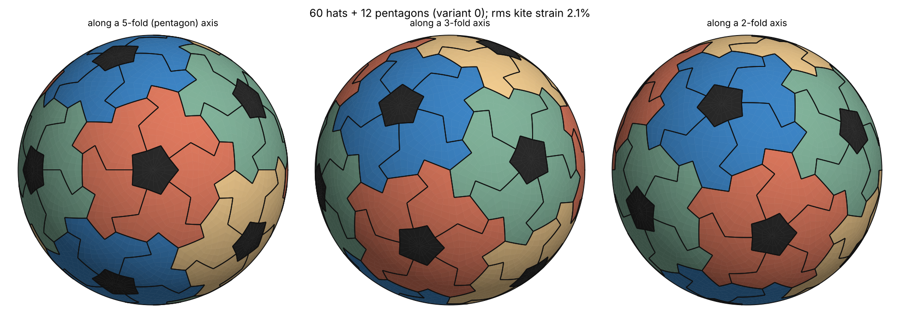
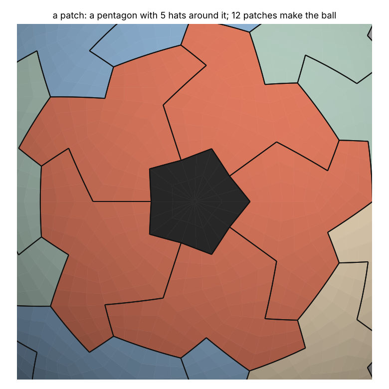
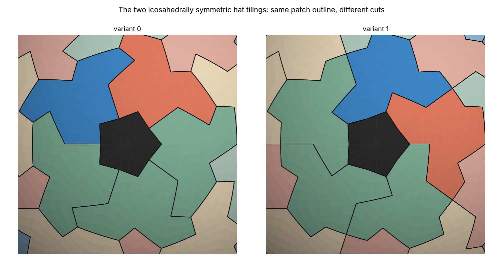
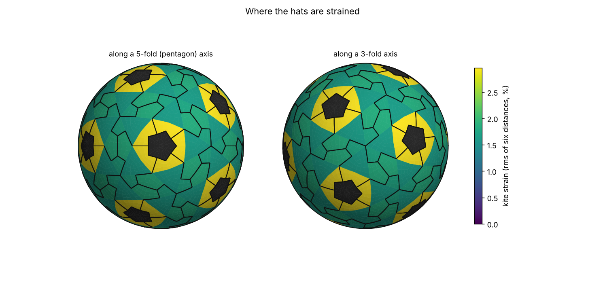

# hexasphere

paper: "The tetrahedral Trionda and the aperiodic Hat Trick on the sphere"
https://doi.org/10.21203/rs.3.rs-11875344/v1

## The Hat Trick ball: the aperiodic hat tile on a hexagonal grid of the sphere



The `n = 2` grid has 92 tiles: 12 pentagons and 80 hexagons (the Goldberg polyhedron GP(3,0)). Cut every hexagon
into 6 kites and there are 480 kites, exactly 60 *hats* of 8 kites each. The **Hat Trick** ball has 72 panels:
60 hats (David Smith's aperiodic monotile) and 12 pentagons. A *patch* is a pentagon with 5 hats around it, and
12 patches close into the ball. `hexasphere.hattrick` finds the hat tiling instead of typing it in:

```python
from hexasphere import hexgrid, projection
from hexasphere.hattrick import HatBall

ball = HatBall.from_frequency(3)                   # or: HatBall.from_grid(grid, n=2) on a hexasphere grid
ball.relax()                                       # put the kite corners on the sphere
ball.report()                                      # panel counts, areas, strain
ball.panels()                                      # outlines of the 72 panels as unit vectors
```

1. **The hat is a polykite** (8 kites of the deltoidal trihexagonal tiling; edges 1 and sqrt 3, one straight edge
   of length 2). `hat_adjacency()` stores it as kite adjacencies, and `flat_hat()` lays it out in the plane and
   checks that it closes up and has the hat's 13 interior angles (90 x4, 120 x5, 240 x2, 270 x2).
2. **Kites on the grid.** Each triangle of the dual triangulation is cut into 3 kites; the 12 pentagon tiles are
   left as holes. `embed_hat` places the hat on the kite surface in every orientation-preserving way: 360 placements.
3. **Exact cover.** Knuth's algorithm X over orbits of the icosahedral rotation group (60 rotations, taken from
   `chiral.icosahedral_rotations` for a grid) finds the hat tilings invariant under it. There are exactly **two**; both
   give every pentagon exactly 5 hats, and the 60 hats are one orbit (a hat has no symmetry, and it is chiral, so
   only rotations act). Both have the same 40-kite patch outline and cut it into hats differently.
4. **The ledger closes with only the pentagons.** Hats put 240 degrees at every pentagon corner (two hat corners of
   120), so a pentagon is a 120-degree pentagon with curvature K = 60 degrees, and 12 x 60 = 720 is the whole
   Gauss-Bonnet total: the hats meet each other with no angle deficit at all.
5. **Geometry.** `relax` moves every kite corner on the unit sphere so each kite stays as close as possible to the flat
   kite (sides 1 and sqrt 3, diagonals 2 and sqrt 3) and straight lines stay straight.

| result (variant 0) | value |
|---|---|
| panels | 60 hats + 12 pentagons = 72 |
| rms / max kite strain | 2.1 % / 5.3 % |
| hat area spread (60 hats) | < 1e-6 |
| hat : pentagon area | 2.32 |
| total area | 4 pi |



The build starts from the tile centres of any hexasphere grid, and the relaxation forgets the projection:
`examples/hat_trick_grids.py` starts at 5.5 % rms strain (Gnomonic) or 4.9 % (Snyder) and both end at 2.1 %.





### Only one resolution works

The number of hats is 7.5 (f^2 - 1) with f = n + 1, an integer only for odd f. For f = 3 it works. For f = 5, 7, 9 the
exact-cover search (`examples/hat_trick_frequencies.py`, `docs/hat_trick_frequencies.json`) finds **no tiling at all**:

| f (n) | tiles | hats | I | T | C5 | no symmetry | no symmetry, either hand |
|---|---|---|---|---|---|---|---|
| 3 (2) | 92 | 60 | 2 | 2 | 16 | many | many |
| 5 (4) | 252 | 180 | none | none | none | none | none |
| 7 (6) | 492 | 360 | none | none | none | none | none |
| 9 (8) | 812 | 600 | none | none | none | none | not exhausted |

"none" means the search ran to exhaustion. The last cell ran 500000 search nodes without finding a tiling and
without finishing. This is a statement about these kite surfaces (Goldberg polyhedra GP(f,0), 12 pentagonal holes,
hats and, in the last column, their mirror images), not about hat tilings in general. GP(m,n) with n > 0 is not covered.

### Scripts and tests

    python examples/hat_trick_ball.py [--variant 1] [--grid gnomonic|snyder] [--mirror]   # figures + docs/hat_trick_ball.json
    python examples/hat_trick_frequencies.py                                              # the table above
    python examples/hat_trick_grids.py                                                    # Gnomonic vs Snyder start geometry
    python -m pytest tests/test_hattrick.py

Needs numpy, scipy and matplotlib (`pip install -e ".[analysis]"`).

**Caveats.** The design is a reconstruction from the description "a pentagon with 5 hats around it, 12 patches make a
ball" (no panel drawing was used), so which of the two tilings, and which hand (`--mirror`), matches a real ball has
to be checked by eye. The panels are slightly strained, not rigid flat hats. The pattern repeats under the
icosahedral group, so it is a hat *demonstration*, not an aperiodic tiling of the sphere. The same construction is
in the [ballgen](https://github.com/brentharts/ballgen) repository as `the_hat_trick_ball.py`.

---

## description of the grid

### base polyhedron

The grid is built by subdividing a base polyhedron into hexagon tiles.
The base polyhedron is an icosahedron, which comprises:
- 20 faces (equilateral triangles)
- 12 vertices
- 30 edges

At the vertices of the icosahedron, instead of an hexagon, a pentagon is constructed.

For a given grid resolution `n`, each edge of the icosahedron goes through exactly `n` hexagon centers (not counting the polygons found at the ends). The inside of faces is then filled with tile-centers by following a triangular pattern.
This allows to cover the icosahedron. Its surface is then mapped to the sphere using a projection.


*Here, `n = 7`*

### projection

There are two available projections in `projection` module:
- `GnomonicProj`: a simple projection, which produces hexagonal tiles about 60% larger (in area) at the corners of a face than at its center.

- `SnyderEAProj`: a more complex projection, slower to compute (roughly 3x slower than Gnomonic projection), but which preserves areas. The implementation is based on [Brenton R S Recht's blog](https://brsr.github.io/2021/08/31/snyder-equal-area.html). See there for more details.

### hexagon tile identifier

A tile identifier has the following pattern: `?XXXXX-YYYYY-ZZZZZ`
- `?` is one of the 20 letters `A ... T`, each letter corresponding to one face of the icosahedron
- `XXXXX`, `YYYYY`, `ZZZZZ` are the integer coordinates of the tile in the triangular mesh covering face `?`. An useful property holds:

`XXXXX + YYYYY + ZZZZZ = 2 * (n + 1)`

---

## getting started

1. Install the package with pip

`$ pip install hexasphere`

2. Import the library in python

`from hexasphere import hexgrid, projection`

## usage

### construction of a grid

1. Create a `HexGrid` object:

`my_grid = hexgrid.HexGrid()`

2. Instantiate a projection system `Projection` associated with this grid:

`my_projection = projection.MyProjection(my_grid)`

3. Provide the projection system to the grid:

`my_grid.projection = my_projection`

### playing with grid resolutions

- Compute closest grid resolution `n` for any desired hex dimension **(in kilometers)**:

```
n = my_grid.compute_n_for_radius(0.25)
n = my_grid.compute_n_for_height(0.25)
n = my_grid.compute_n_for_side(0.25)
```

- Retrieve average hex dimension **(in kilometers)** for any given resolution `n`:

```
my_grid.compute_radius_for_n(n)
my_grid.compute_height_for_n(n)
my_grid.compute_side_for_n(n)
```

### encoding and decoding

- To find the string identifier of the hexagon to which a geographic point `(lat, lon)` belongs, call:

```
hex_identifier = my_grid.latlon_to_hex(lat, lon, n, out_str=True)[0]
```

- To find the `(lat, lon)` coordinates of the center of an hex, call:

```
my_grid.hex_to_latlon(hex_identifier, in_str=True)
my_grid.hex_to_latlon(hex_identifier, n, in_str=True) # n is here not required
```

### overlapping grids

`grid.latlon_to_hex` also supports overlapping grids:

```
value = 12 # Overlap distance (in km)
my_grid.set_overlap(value)
```

The method `grid.latlon_to_hex` returns the list of distinct hexes a point of coordinates `(lat, lon)` belongs to:

```
hexes_identifier = my_grid.latlon_to_hex(lat, lon, n, out_str=True)
```


### playing with hexagons

#### retrieving shape data

One can also deal with an `Hexagon` object instead of an hexagon string identifier:

```
hex_object = my_grid.latlon_to_hex(lat, lon, n)[0]
hex_object = hexgrid.Hexagon(my_grid, str_id=hexagon_identifier)
```

The coordinates of the vertices of the corresponding shape can then be retrieved:

```
shape_coordinates = hex_object.retrieve_polygon(out_latlon=True)
```

#### moving on the grid

To retrieve a neighboring hex:

```
hex_neighbor = hex_object.compute_neighbor(dP=(0, 1, -1))
```

To retrieve the list of hexes in the k-ring centered on the hex object:

```
hexes = hex_object.k_ring(k, out_str=True)
```

---

## grid analysis and plots (optional)

`hexasphere.analysis` (numpy + scipy) and `hexasphere.plot` (matplotlib) measure and draw a grid.
Install the extras with `pip install -e ".[analysis]"`.

```python
from hexasphere import hexgrid, projection, analysis, plot

grid = hexgrid.HexGrid()
grid.projection = projection.SnyderEAProj(grid)

data = analysis.grid_data(grid, n=8)      # 812 tiles: centres, exact areas, corners
analysis.area_stats(data)                 # min / max / cv of tile area, pentagon mean
analysis.multipole_spectrum(data)         # power per spherical-harmonic degree
plot.grid_3d(data); plot.area_map(data); plot.spectrum(data)
```

`python examples/analyze_grids.py 8` writes `docs/grid_analysis.json` and the figures in `docs/`.

### What it shows (n = 8, 812 tiles, 12 pentagons)

| projection | max/min tile area | cv of area | mean pentagon area / mean |
|---|---|---|---|
| Gnomonic | 2.51 | 0.139 | 0.479 |
| Snyder   | 1.29 | 0.027 | 0.780 |

Snyder is far more uniform, but its pentagons are still about 22% smaller than average.
Areas are those of the polygon through the tile corners with great-circle edges, which is exact for
Gnomonic (straight lines in the gnomonic plane are great circles) and an approximation for Snyder.

**Symmetry selection rule.** Both grids are invariant under all 60 rotations of the icosahedron
(checked numerically), and the tile-area field is also inversion symmetric. A function on the sphere
with that symmetry can only contain spherical-harmonic degrees l = 0, 6, 10, 12, 16, 18, 20, ...
(l = 1-5, 7-9, 11, 13-15, 17, 19 are absent). The measured spectrum agrees to about 1e-25 of the leading
l = 6 term, for both projections. So the lowest-order imperfection of an icosahedral grid is always an l = 6 pattern.

### Fixes to `SnyderEAProj`

- `inv_project` compared floats with `==` to detect a vertex, so some pentagon centres produced NaN
  (`0/0`); it now uses a tolerance.
- `project` returned the unscaled unit vector at an exact vertex instead of the face-plane point.

Both are covered by `tests/test_analysis.py`.

---

## chiral hexagonal tilings (`hexasphere.chiral`)

The hexagonal grid is mirror symmetric. Pushing it through an area-preserving, icosahedrally equivariant flow
gives a **chiral** tiling that keeps every tile's area and every shared seam, but loses all mirror symmetry
(a "pinwheel" hex grid, with a left- and a right-handed version).

```python
from hexasphere import hexgrid, projection, analysis, chiral, plot

grid = hexgrid.HexGrid(); grid.projection = projection.GnomonicProj(grid)
data = analysis.grid_data(grid, n=8)
twisted = chiral.chiral_grid(grid, data, tau=0.2)     # tau < 0 gives the mirror image
chiral.symmetry_counts(grid, twisted.centers)         # {'proper': 60, 'improper': 0, 'chiral': True}
plot.grid_3d(twisted, values=chiral.perimeters(twisted) / chiral.perimeters(data))
```

The flow is `v = p x grad f` with `f = sum_a (p.a)^6` over the six five-fold axes `a`. Since `f` is invariant
under the 60 icosahedral rotations, the flow commutes with them; it is divergence free, so it preserves area;
it vanishes at the 12 pentagon centres, 30 edge midpoints and 20 face centres; and it is odd under reflections,
so a mirrored tiling equals the flow at time `-tau`. This is the same construction as the chiral Trionda family in
the [ballgen](https://github.com/brentharts/ballgen) repository. `tau` is the largest distance in radians of arc
a point can move.

Measured on the Gnomonic grid, n = 8 (`python examples/chiral_tilings.py`, results in `docs/chiral_sweep.json`):

| tau | max change of a tile's area | mean tile perimeter | max tile perimeter | symmetries kept (of 60 + 60) |
|---|---|---|---|---|
| 0 | 1e-14 | 1.000 | 1.000 | 60 + 60 |
| 0.05 | 3e-6 | 1.009 | 1.025 | 60 + 0 |
| 0.1 | 1e-5 | 1.035 | 1.098 | 60 + 0 |
| 0.2 | 4e-5 | 1.135 | 1.379 | 60 + 0 |
| 0.3 | 6e-5 | 1.286 | 1.779 | 60 + 0 |

Area changes are discretisation error of the polygon rings (`edge_samples` points per edge), not of the flow.
Chirality has a cost: seams get longer and the tiles near the edge midpoints are sheared hard, so the useful
range is small `tau`. The test suite checks equivariance under the rotations, the inverse flow, the fixed points,
area preservation, the mirror relation, and that the two enantiomers are different tilings.
